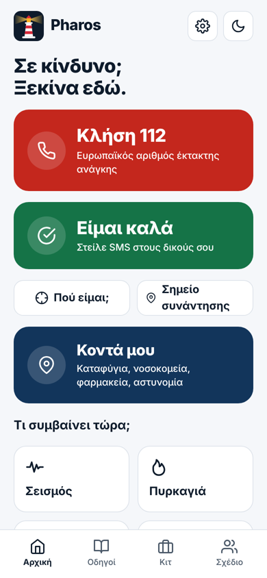
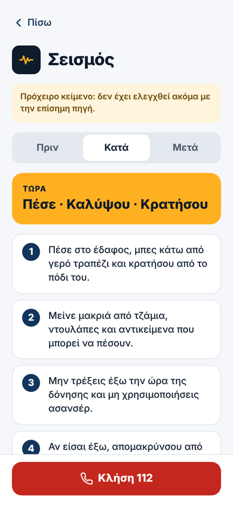
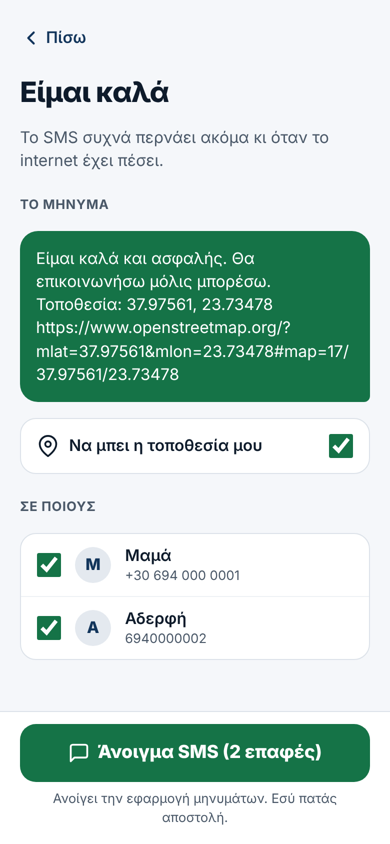
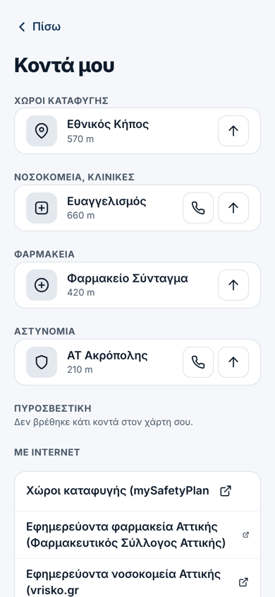
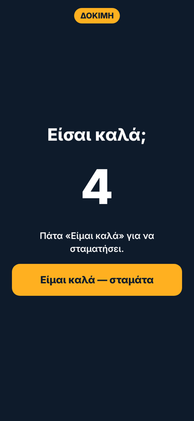

# Pharos

**Everything you need in an emergency. No internet needed.**

Pharos (Greek for *lighthouse*) is a free, open-source emergency app for earthquakes, wildfires, floods and heatwaves. After the first visit it works completely offline, it never asks for an account, and everything you type stays on your phone.

[](https://github.com/Nikpar005/pharos/actions/workflows/ci.yml)


<p>
  
  
  
  
  
</p>

> ⚠️ Pharos does not replace 112 or instructions from the authorities. The guides are **drafts** until each one is checked against its official source (see [Content rules](CONTRIBUTING.md#content-rules)).

## What it does

| | |
|---|---|
| **Call 112** | One big button. A normal phone call, so it works without internet. |
| **"I'm okay"** | Opens your messages app with a ready text to the people you chose, optionally with your coordinates. SMS often gets through when data doesn't. |
| **Where am I?** | Big GPS coordinates to read out to the 112 operator. GPS works without internet. |
| **Meeting point** | Distance and an arrow to your family's meeting point. Uses only GPS and the compass, with no map download. |
| **Guides** | What to do before, during and after each hazard, with the official source on every guide. |
| **Emergency kit** | A checklist with a 6-month reminder to check expiry dates. |
| **Family plan** | Meeting points, an out-of-area contact, members' needs. Print it, or share it with a QR code. |
| **Offline maps** | Download your region once (Attica, Evia, Andros…). Hospitals, pharmacies, drinking water and your meeting points are highlighted. |
| **I'm trapped** | A loud distress whistle (3 blasts, pause) on a black screen, plus what to do while you wait for rescuers. |
| **First aid** | 18 topics (bleeding, burns, choking, recovery position, heatstroke, poisoning, stroke…), based on the ΕΚΑΒ handbook. Loaded only when opened (~9 KB). |
| **CPR** | ERC 2025 steps, 110 bpm metronome, compressions-only or 30:2, a clock that shows how long CPR has run, and a beep plus voice prompt every 2 minutes to swap rescuers. |
| **Incident log** | Times of collapse, CPR start, defibrillator shocks and your notes, ready to read out to the ambulance crew. |
| **"Are you okay?"** | Optional. If the screen is tapped rapidly with no sense (panic, a fall, a seizure), Pharos asks "Are you okay?" for 5 s, then sounds a loud siren with flashing light and shows a message for bystanders, then opens the 112 dialer and a GPS SMS. "I'm okay" stops it at any time. |
| **Nearby** | Nearest assembly points, hospitals, pharmacies, police and fire stations from your downloaded map, offline, with call and directions buttons. Online links to official shelter, on-duty pharmacy and hospital pages and the fire-risk map. |
| **Evacuation checklist** | What to take in 5 minutes, and what to do if you have more time, with a timer. |
| **Phrases** | 11 emergency phrases in English, German, French and Italian with the Greek, shown large to hand the phone to someone. |
| **Phone setup** | Step-by-step for Emergency SOS, emergency alerts, medical info and quick-launch on Android and iPhone. |
| **How ready are you?** | A 0–100 score from your plan, kit, last drill, phone setup and maps, with what to do next. |
| **SOS light** | Torch and screen flash ··· ––– ···, slow enough to be safe for photosensitive people. |
| **Family drill** | A 5-minute checklist, suggested every 6 months. |
| **Simple mode** | Just "Call 112" and "I'm okay", huge, for older relatives. |
| **Accessibility** | Large text, voice guidance with the phone's own voices, screen-reader labels, reduced-motion support. |
| **Quick launch (Android app)** | A Quick Settings tile and a long-press shortcut that opens the 112 dialer. |
| **Battery** | Time left and saving tips (and a warning on Home under 20%). Hidden developer panel with live mA in the Android app: tap the logo 7 times. |
| **Earthquakes now** | Latest quakes around Greece from EMSC, when online. Clearly marked as *not* an official warning. |

## How it is built (and why)

- **Offline-first PWA.** A service worker caches every file on the first visit. Nothing is fetched at runtime.
- **Small enough for old phones.** Preact, no UI library, no web fonts, inline SVG icons. Start-up is about 33 KB of gzipped JS (only the language you use is loaded), and CI fails if it grows past the [budget](scripts/check-size.mjs).
- **Heavy parts load only when used.** The map engine (MapLibre, ~460 KB) is downloaded together with your first map region, never on a normal visit.
- **Battery-friendly.** GPS is read once when you ask, not in the background. The compass only runs while its screen is open and redraws only when the heading moves 3° or more. Night mode is true black, which saves power on OLED screens.
- **No server, no tracking.** Data is in IndexedDB on your device. A shared plan travels inside the link's `#fragment`, which browsers never send to any server ([how](src/lib/plan.ts)).
- **Content is data.** Guides, countries and the kit list are YAML files validated by [schemas](schemas/content.mjs). Adding a country or a language needs no code.

```
content/          guides, countries, kit list (YAML), the part most contributors touch
schemas/          what valid content looks like (Zod)
scripts/          content build + size budget
src/lib/          SMS links, geo maths, plan sharing, storage (unit tested)
src/screens/      one file per screen
src/i18n/         interface text, one JSON per language
tests/            Vitest
```

## Sizes

| What | Size |
|---|---|
| First visit (everything for offline use) | ~240 KB (~120 KB over the network, compressed) |
| Start-up code | ~33 KB JS + ~4.4 KB CSS (gzipped), budget 45 KB enforced in CI |
| Places for *Nearby* | a small JSON next to each map region (sizes in the *Build offline maps* summary) |
| Map engine + label fonts, once, with the first map | ~0.5 MB + ~0.46 MB |
| Each map region | measured by the *Build offline maps* workflow (see its run summary) |
| Android app | measured by the *Android app* workflow (see its run summary) |
| Your data (plan, kit, settings) | a few KB |

## Run it

```bash
npm ci
npm run dev        # http://localhost:5173
npm run check      # everything CI runs: content, types, tests, build, size
```

Offline mode only works in a production build: `npm run build && npm run preview`, then turn on airplane mode.

**Maps:** run the *Build offline maps* workflow once (Actions tab). It cuts each region in [`content/regions.yaml`](content/regions.yaml) from OpenStreetMap, publishes them to the `maps` release, and the Pages deploy serves them. To add a region, add its bounding box there.

**Android:** see [docs/ANDROID.md](docs/ANDROID.md).

Browser support: Chrome/Android 80+, Safari/iOS 14+. Some features depend on the platform: battery level (not on iPhone), live battery current and reliable torch (Android app only), contact picker (Android Chrome).

## Contribute

You don't need to write code to help. See **[CONTRIBUTING.md](CONTRIBUTING.md)** for the easiest ways to start:

- **Add your country** (one YAML file)
- **Translate** the app or a guide
- **Check a guide** against official sources so it can lose its "draft" label

Pick something from [docs/IDEAS.md](docs/IDEAS.md), or look for issues labelled [`good first issue`](https://github.com/Nikpar005/pharos/labels/good%20first%20issue).

## Roadmap

- [x] Offline core: 112, "I'm okay", location, guides, kit, family plan, QR sharing
- [x] Offline maps, trapped whistle, CPR metronome, SOS light, drill, simple mode, battery panel, earthquakes feed
- [x] Android app project (Capacitor) with size-reporting build
- [x] v0.3: ERC 2025, CPR clock, incident log, "Are you okay?", Nearby, evacuation, phrases, phone setup, readiness score, large text, voice

More ideas, written as ready-to-open issues: **[docs/IDEAS.md](docs/IDEAS.md)**.

- [ ] Every guide reviewed against official sources (Greece, Cyprus)
- [ ] More countries and languages
- [ ] End-to-end tests (Playwright) that run the app in airplane mode
- [ ] Official municipal shelters (today: OpenStreetMap assembly points + a link to mySafetyPlan) / assembly points as open data on the map
- [ ] Messages without any network via Meshtastic (LoRa) radios (needs a licence decision: its libraries are GPL-3.0)
- [ ] `pharos-cli` in Rust: link checking and review-date reports for the content
- [ ] Publish on Google Play and F-Droid

## Where the information comes from

Every guide, procedure and number lists its official sources in its file under [`content/`](content/) and on screen. The main ones:

- **First aid and CPR:** ΕΚΑΒ, *«Μαθαίνω Πρώτες Βοήθειες – Είμαι ασφαλής»*, published by the Greek Ministry of Health ([moh.gov.gr](https://moh.gov.gr/articles/health/dieythynsh-prwtobathmias-frontidas-ygeias/draseis-kai-programmata-agwghs-ygeias/agwgh-ygeias/entypo-kai-optikoakoystiko-yliko/12791-bibliario-prwtwn-bohtheiwn?fdl=27980)), and the European Resuscitation Council Guidelines 2025. Written in our own words, not copied.
- **Earthquakes, wildfires, floods:** ΟΑΣΠ, General Secretariat for Civil Protection, Hellenic Fire Service.
- **Heatwaves:** ΕΟΔΥ.
- **Online links:** mySafetyPlan (shelters), Pharmaceutical Association of Attica (on-duty pharmacies), General Secretariat for Civil Protection (fire-risk map).
- **Maps and nearby places:** © OpenStreetMap contributors (ODbL), via Protomaps. **Earthquake feed:** EMSC (CC BY 4.0), USGS.

None of these organisations endorse Pharos. All safety content is marked *draft* until a maintainer has checked it line by line against its source.

## License

Code: [MIT](LICENSE). Content in `content/`: [CC BY-SA 4.0](content/LICENSE.md).

---

### Ελληνικά

Το Pharos είναι δωρεάν εφαρμογή ανοιχτού κώδικα για σεισμό, πυρκαγιά, πλημμύρα και καύσωνα. Μετά το πρώτο άνοιγμα δουλεύει χωρίς internet, δεν θέλει λογαριασμό και ό,τι γράφεις μένει στο κινητό σου. Για να βοηθήσεις, δες το [CONTRIBUTING.md](CONTRIBUTING.md).
